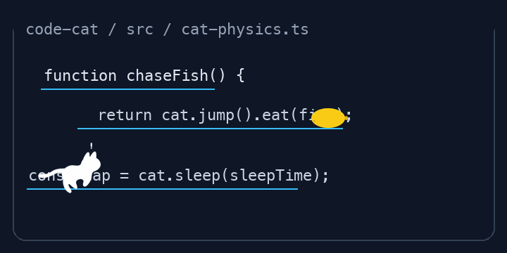

# Code Cat 🐱

코드 에디터에 사는 귀여운 고양이. 코드를 플랫포머 지형처럼 돌아다니며 생선을 쫓아 먹습니다.

## Features

- 🐱 **Idle Detection** — 일정 시간 입력이 없으면 고양이가 나타남
- 🐟 **Fish Chase** — 랜덤 위치에 생선 스폰 → A* 경로 탐색 → 추적 → 먹기
- 🏃 **Platformer Movement** — 코드 텍스트를 지형으로 인식, run/jump/fall
- 🐾 **Footprints** — 달리는 경로에 발자국 표시
- 🎨 **Customizable** — 고양이 색상, 속도, idle 시간 등 설정 가능

## Settings

| Setting | Default | Description |
|---------|---------|-------------|
| `codeCat.enabled` | `true` | 켜기/끄기 |
| `codeCat.catColor` | `#ffffff` | 고양이 색상 (hex) |
| `codeCat.idleTimeout` | `2` | 입력이 멈춘 뒤 고양이가 다시 나타나기까지의 시간 (초) |
| `codeCat.sleepTime` | `8` | 한 세션의 생선을 다 먹은 뒤 sleep 상태로 쉬는 시간 (초) |
| `codeCat.fishSessionCount` | `5` | sleep 전에 연속으로 추적하는 생선 수 |
| `codeCat.animationSpeed` | `1.0` | run/jump/fall 및 추적 템포 전체에 적용되는 속도 배수 (0.5~2.0) |
| `codeCat.showFootprints` | `true` | 발자국 표시 |

## Commands

- `Code Cat: Toggle` — 고양이 켜기/끄기

## How It Works

1. 에디터에서 일정 시간 입력이 없으면 고양이가 커서 근처에 스폰
2. 잠시 후 생선이 나타나면 놀란 표정 → 추적 → 먹기
3. 같은 세션 안에서는 생선을 먹은 뒤 마지막 먹기 포즈를 잠시 유지한 채 다음 생선을 기다림
4. 설정한 횟수만큼 연속으로 먹으면 잠시 sleep 상태로 쉬었다가 다음 세션을 시작
5. 타이핑 재개 시 즉시 사라짐

## Packaging

- 로컬 VSIX 패키징: `npm run package:vsix`
- 생성된 `.vsix` 설치: `code --install-extension code-cat-<version>.vsix`
- 마켓플레이스 배포 절차: [docs/publishing.md](docs/publishing.md)
