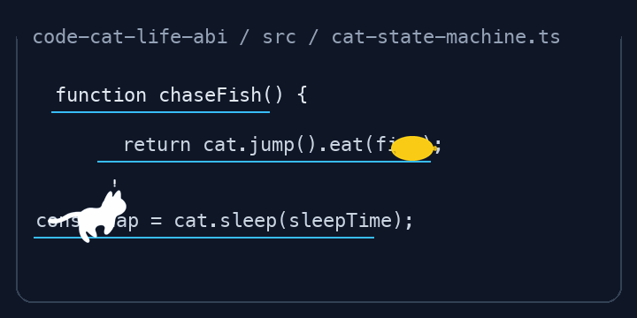

# Code Cat Life Abi

A VS Code cat that treats your code like real terrain.  
It appears when you stop typing, runs and jumps across text blocks, and chases fish inside the editor.



## What Makes It Fun

- Your code is not just a backdrop. The cat treats visible text as terrain, avoiding empty lines and moving with run/jump/fall behavior.
- Fish chasing is not a random animation loop. The cat builds a path inside the visible code area and mixes in short diagonal moves for a more natural chase.
- It does not just eat once and disappear. In the same session, the cat keeps its eating pose briefly, waits for the next fish, and goes to sleep only after the configured number of catches.
- You can tune the mood of the scene with color, spawn timing, session length, animation speed, and paw prints.

## Behavior

1. When typing stops, the cat appears on text near the cursor.
2. When a fish appears, the cat reacts with a surprised expression and starts chasing along the code terrain.
3. Within the same session, the cat keeps the final eating pose briefly and waits for the next fish.
4. After catching `codeCatLifeAbi.fishSessionCount` fish in a row, it enters a sleep state for `codeCatLifeAbi.sleepTime`.
5. If you start typing again or move the cursor, the cat disappears immediately.

## Settings

| Setting | Default | Description |
|---------|---------|-------------|
| `codeCatLifeAbi.enabled` | `true` | Enable or disable the extension |
| `codeCatLifeAbi.catColor` | `#ffffff` | Cat color |
| `codeCatLifeAbi.idleTimeout` | `2` | Seconds of inactivity before the cat appears |
| `codeCatLifeAbi.sleepTime` | `8` | Seconds the cat sleeps after one fish session ends |
| `codeCatLifeAbi.fishSessionCount` | `5` | Number of consecutive fish chased before sleep |
| `codeCatLifeAbi.animationSpeed` | `1.0` | Speed multiplier for run/jump/fall and chase timing |
| `codeCatLifeAbi.showFootprints` | `true` | Show paw prints while the cat is running |

## Commands

- `Code Cat Life Abi: Toggle`: Immediately enable or disable the extension.

## Installation

Before Marketplace release, you can install it directly from a VSIX package.

```bash
npm run package:vsix
code --install-extension code-cat-life-abi-<version>.vsix
```

## Development

```bash
npm install
npm test
npm run watch
```

- Architecture: [docs/architecture.md](docs/architecture.md)
- Movement rules: [docs/movement-rules.md](docs/movement-rules.md)
- Publishing guide: [docs/publishing.md](docs/publishing.md)

## Packaging

- Local VSIX packaging: `npm run package:vsix`
- Marketplace publishing: `npm run publish:vsix`

## License

[MIT](LICENSE)
