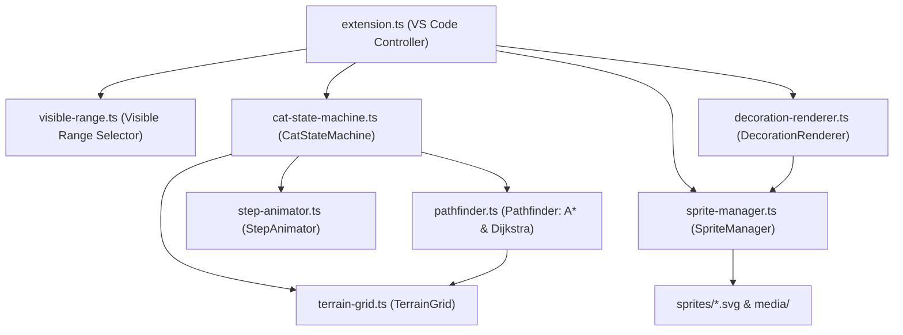
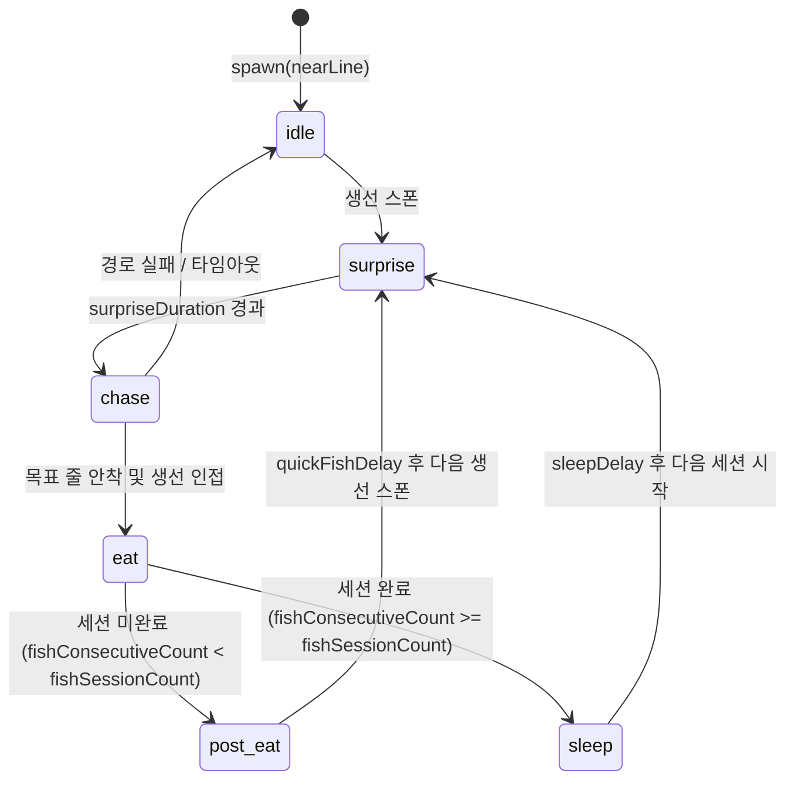
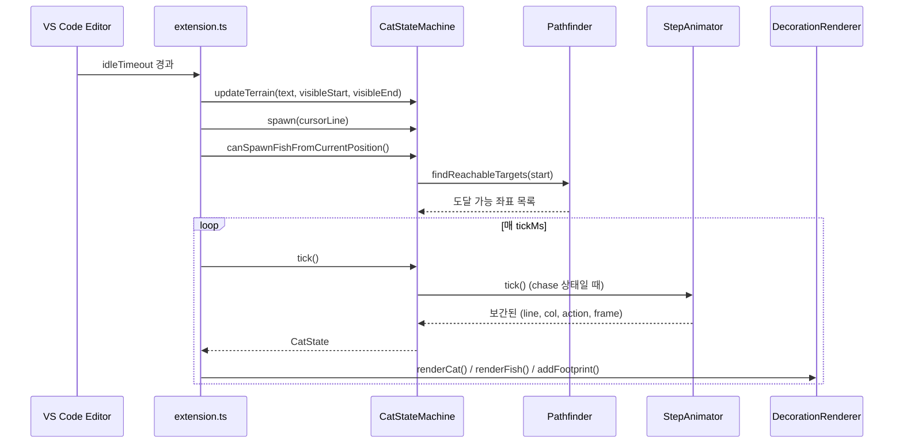

# Code Cat Life Abi — Architecture

리팩토링된 프로젝트의 모듈 구조, 상태 머신, 실행 흐름을 정리한 문서입니다.

## 1. 모듈 의존 구조

### 모듈별 책임
| 모듈 | 책임 |
| :--- | :--- |
| `extension.ts` | 에디터 이벤트 구독(타이핑, 커서, 스크롤, 탭 전환), 유휴 타이머, 상태바, 로그/커맨드 |
| `visible-range.ts` | 접힌 코드(fold)로 나뉜 영역 중 커서가 속한 단일 연속 구간 선택 |
| `terrain-grid.ts` | 가시 영역 내 텍스트를 2D 바닥 격자로 색인 (`16칸` 이상 내부 공백은 별도 구간으로 분리) |
| `pathfinder.ts` | 단일 Dijkstra로 도달 가능 좌표 일괄 탐색 및 A*로 `MoveStep[]` 최단 경로 생성 |
| `step-animator.ts` | `walk`/`jump`/`fall` 스텝 보간 및 착지(`land`) 포즈 처리 |
| `cat-state-machine.ts` | 고양이 행동 상태 전이 및 생선 세션(`fishSessionCount`, `sleepTime`) 관리 |
| `decoration-renderer.ts` | `TextEditorDecorationType`을 이용한 고양이·생선·발자국 CSS/SVG 렌더링 |
| `sprite-manager.ts` | `sprites/*.svg` 로딩, `catColor` 치환, Base64 Data URI 캐싱 |

---

## 2. 고양이 상태 머신 (State Machine)

---

## 3. 틱(Tick) 실행 흐름

